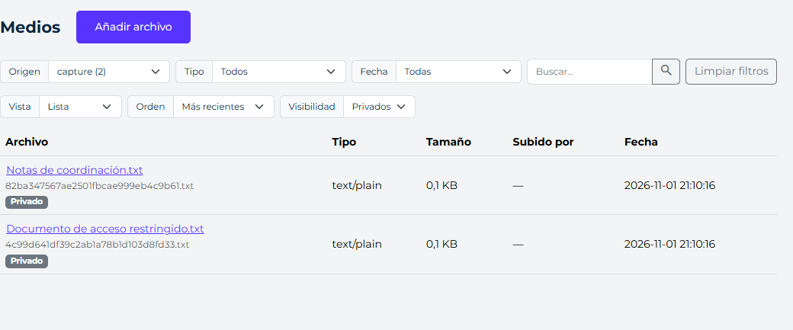
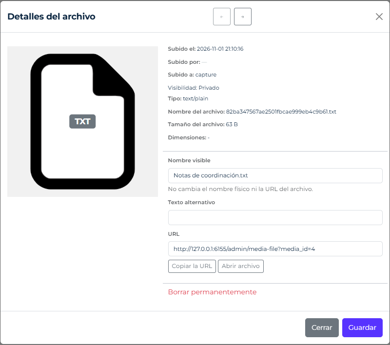

# Archivos privados y enlaces de descarga

Desde 4.7.0, la biblioteca admite almacenamiento público y privado. Todas las imágenes y documentos persistentes deben gestionarse mediante `media-library`, también cuando los produce otro módulo. La API de descargas es una utilidad de entrega; no sustituye el registro, almacenamiento ni los permisos de Media.

## Configuración

Combina estas secciones con las existentes en `config/app.php`:

```php
'media' => [
    'scope' => 'global', // global, user o tenant
    'visibility' => 'public',
    'private_root' => null, // null: ABSPATH . 'private'; admite una ruta absoluta propia
    'sources' => [
        'documents' => ['visibility' => 'private', 'private_permission' => 'documents.files'],
    ],
],
'files' => ['downloads' => [
    'enabled' => true,       // false por defecto; desactiva emisión y uso de enlaces
    'ttl_seconds' => 86400,  // 0: sin caducidad
    'max_downloads' => 0,    // 0: sin límite
    'require_auth' => false,
    'audit' => true,
]],
```

La configuración por origen prevalece sobre `media.visibility`; las integraciones PHP pueden indicar la visibilidad por archivo. Los endpoints nativos de carga eligen el destino desde el servidor, sin aceptar rutas o cambios de esa política desde el navegador. Se rechazan hotlinks en orígenes privados: el servidor remoto controla su exposición.

| Visibilidad | Raíz predeterminada | Ruta relativa guardada |
| --- | --- | --- |
| Pública | `ABSPATH . 'public'` | `uploads/<ámbito>/<origen>/<año>/<mes>/<archivo>` |
| Privada | `ABSPATH . 'private'` | `media/<ámbito>/<origen>/<año>/<mes>/<archivo>` |

El ámbito global omite sus segmentos; usuario y tenant añaden `user/<id>` o `tenant/<id>`. Los nombres físicos privados son aleatorios; `original_name` conserva el nombre visible. Original y variantes comparten almacenamiento.

Sitúa preferiblemente una raíz personalizada fuera del document root. La raíz `private/` predeterminada está bloqueada por los archivos Apache/Nginx distribuidos; incorpora esos cambios en servidores personalizados antes de habilitar archivos privados. PHP no puede impedir que un servidor mal configurado entregue archivos estáticos. La raíz privada de la biblioteca no admite ubicarse en `public/`. Las rutas privadas rechazan escapes, unidades de Windows y enlaces simbólicos.

## Acceso interno

Se conservan `auth` y los permisos habituales de [la biblioteca](media-library.md). Los privados requieren además:

| Operación | Permiso adicional |
| --- | --- |
| Listar, seleccionar, consultar o abrir | `media.private.view` |
| Subir | `media.private.add` y `media.private.view` |
| Editar | `media.private.edit` y `media.private.view` |
| Eliminar | `media.private.delete` y `media.private.view` |
| Emitir o revocar enlaces | `media.private.share` y `media.private.view` |
| Cambiar visibilidad | `media.private.visibility`; también `media.private.view` si ya es privado |

`media.sources.<origen>.private_permission` sustituye el prefijo completo `media.private` para ese origen: por ejemplo, `documents.files.view`. El permiso general no permite saltarse esa restricción. Se filtran filas, totales y opciones antes de paginar. El superadministrador conserva el bypass habitual; los demás roles reciben permisos explícitos. El ámbito tenant requiere sesión y tenant autorizados y coherentes.

La biblioteca identifica los privados, permite filtrar por visibilidad y muestra su estado en detalles. Campos y selector utilizan la misma autorización. GET/HEAD `admin/media-file?media_id=<id>&variant=<clave>` entrega originales y miniaturas con autorización en cada petición. Las respuestas de presentación omiten rutas físicas privadas. Copiar esa URL interna no concede acceso externo.



*El filtro «Privados» muestra solo los archivos que el actor puede consultar. Captura real de una instalación temporal con datos ficticios, GFrame 4.7.1.*



*Los detalles muestran «Visibilidad: Privado». La URL apunta al controlador autorizado; copiarla no emite un enlace externo. Esta pantalla no contiene controles de emisión de enlaces ni de cambio de visibilidad.*

Los servicios PHP no leen sesiones y presuponen un llamador autorizado. Para aplicar permisos dentro de `MediaLibraryService`, inyecta `MediaAccessPolicy` como quinto argumento con un comprobador del actor/tenant verificados; el controlador nativo lo hace. Sin política, el llamador debe autorizar cada operación. Para reglas por registro, además de origen y ámbito, utiliza endpoints propios y consultas autorizadas; un permiso de biblioteca no implementa esas reglas particulares.

## Biblioteca desde PHP

```php
use GFrame\Media\{MediaModel, MediaLibraryService, MediaStorage, MediaScope};

// Código servidor: autoriza previamente al actor y resuelve el ámbito real.
$storage = new MediaStorage(ABSPATH . 'public', ABSPATH . 'private');
$media = new MediaLibraryService(new MediaModel(), $storage);
$scope = MediaScope::global();
$result = $media->registerLocalFile($temporaryFile, 'Documento.pdf', 'documents', $scope, [], 'private');
if ($result['status'] !== 'success') return $result;
$mediaID = (int)$result['data']['media_id'];
$grant = $media->issueDownload($mediaID, $scope, ['ttl_seconds' => 3600]);
$url = rtrim(site_url, '/') . '/media-access?token=' . rawurlencode($grant['token']);
```

GET/HEAD `media-access?token=...` verifica autorización, vigencia, archivo y correspondencia con el registro y ámbito persistidos. No confía en un tenant del navegador. Eliminar el registro, mover el archivo o cambiar su visibilidad invalida ese enlace. Revoca mediante `$media->revokeDownload($mediaID, $grantID, $scope)`; conserva `grant_id` al emitirlo.

`changeVisibility($mediaID, 'private'|'public', $scope)` traslada original y variantes, actualiza el registro e intenta revertir los traslados si falla. Conserva ID y nombre visible, cambia URLs físicas y no recupera copias ya descargadas o guardadas en cachés externos. Comprueba su resultado. POST `ajax/admin/media/visibility` admite `media_id` y `visibility`, con `auth`, `media.edit`, permisos privados y CSRF. No hay controles visuales de cambio de visibilidad ni de emisión/revocación de enlaces.

La sincronización nativa recorre solo públicos. Una integración PHP autorizada puede llamar a `MediaSyncService::synchronize($scope, 'private')`. No añade carpetas lógicas ni ámbitos por tipo de contenido.

## Utilidades de entrega

`PrivateDownloadService` y `PrivateFileStorage` son utilidades de bajo nivel que utiliza la entrega privada. No suben ni registran imágenes o documentos, y no deben utilizarse para crear un almacén paralelo. La integración de módulos debe incorporar el archivo mediante `MediaLibraryService`, conservar su `media_id` y emitir o revocar enlaces con `issueDownload()` y `revokeDownload()`, como en el ejemplo anterior.

La ruta nativa `media-access` entrega el recurso mediante GET/HEAD. Un endpoint personalizado debe conservar la autorización del actor, ámbito y medio, sin aceptar rutas físicas ni identidades enviadas por el navegador. Los tokens no deben aparecer en logs HTTP, analítica ni páginas con recursos de terceros. La lógica de acceso vigente corresponde a la integración; un enlace por posesión puede compartirse y no demuestra identidad por sí solo.

## Entrega y conservación

Se transmiten bytes desde PHP con `Cache-Control: private, no-store`, `nosniff` y política de referencia restrictiva. Se admite un rango de bytes y HEAD. La entrega externa es como adjunto; la interna permite mostrar formatos pasivos compatibles.

`max_downloads` cuenta solicitudes GET autorizadas que pueden entregar contenido, incluidos rangos. HEAD y rangos inválidos no consumen usos. El consumo es atómico entre workers y ocurre antes de transmitir: una interrupción puede consumirlo. Para reanudación/reproducción utiliza 0 por defecto y controla vigencia o identidad. No cuenta descargas completas.

Las autorizaciones se guardan en SQL mediante el módulo `runtime-storage`, en la conexión `storage.connection` (null usa la predeterminada). La comprobación y el consumo son transaccionales; no se crean archivos `.downloads/*.json`. Todos los workers deben compartir la base de datos y tener acceso a los documentos. La huella del contenido se comprueba en cada resolución: sustituir el archivo invalida el enlace y cada petición añade una lectura completa previa. El registro opcional usa el log PHP con evento e ID, sin token. Las autorizaciones vencidas se limpian al crear registros o mediante `DatabaseStateStore::prune()`; los archivos de contenido los administra el proyecto.

La caducidad del enlace no borra archivos ni afecta a otros enlaces. La conservación del archivo pertenece a una política explícita del proyecto. Su trabajo programado elimina los recursos autorizados al vencer esa política; las solicitudes posteriores se rechazan al faltar el archivo. En la biblioteca usa `delete()` para limpiar registro y variantes. Para retirar disponibilidad antes del borrado físico, utiliza el callback de autorización de la integración. No se presuponen plazos ni reglas de negocio.

## Actualización

Aplica las migraciones MySQL/SQLite de `media-library` mediante el actualizador habitual. `media.visibility` comienza en `public`, sin mover archivos existentes. Revisa la protección de `private/` en servidores personalizados antes de activar cargas privadas. Consulta [actualizaciones](actualizaciones.md) y [servidores web](servidores-web.md).
