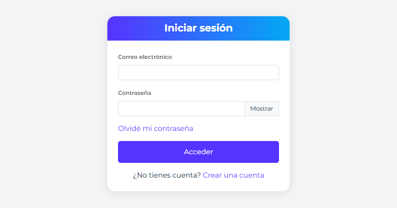

# Autenticación

## Protección de solicitudes y correo de acceso

El controlador estándar conserva los mensajes de registro, login y reenvío. Antes de ejecutar bcrypt o solicitar correo reserva cupo por dirección IP y por identidad normalizada. `auth.rate_limit` configura `enabled` (true), `window_seconds` (900), `ip_attempts` (100), `login_attempts` (10) y `mail_attempts` (5). Registro, recuperación y reenvío comparten el cupo de correo por identidad; reset tiene su propio cupo por hash del token. Los intentos aceptados consumen cupo aunque luego fallen o tengan éxito. El modelo mantiene su API y no aplica una política HTTP a sus llamadas internas. Para correos inexistentes, login verifica un hash bcrypt de relleno de coste 12; reduce la diferencia de trabajo, sin prometer tiempo constante.

El almacenamiento `storage/auth-rate/attempts.json` necesita escritura y bloqueo fiable. Las reservas de IP e identidad se hacen bajo el mismo bloqueo antes de realizar el trabajo. Se eliminan contadores vencidos en cada solicitud y se limita el tamaño del almacenamiento; no se crean archivos por correo. Un almacenamiento corrupto, lleno o inaccesible rechaza la operación con `auth_rate_limit_unavailable`; el cupo agotado devuelve `auth_rate_limited` y `data.retry_after`. Varios servidores necesitan un almacenamiento compartido con bloqueos fiables para compartir cuotas. Detrás de un proxy configura `security.trusted_proxies`; no se confía directamente en la IP reenviada por un visitante.

Los correos de verificación y recuperación usan `AccessMailService`. Si `notifications-email` está instalado se persisten en la cola de correo existente, procesada por su tarea cron; asegúrate de que el runner funciona. No se lanza un proceso por correo. Sin ese módulo, el envío es síncrono con timeout SMTP de diez segundos por operación, y la respuesta puede tardar mientras SMTP responde. Esto no constituye un plazo integral para todo el intercambio SMTP. El fallo al persistir una cola instalada no provoca otro envío alternativo.

Antes de enviar un correo de acceso encolado se comprueban el token actual de la cuenta, su estado y su caducidad estándar de 24 horas. Los mensajes vencidos o sustituidos por una solicitud posterior terminan como fallidos sin reintentos. La cola contiene el enlace de acceso y debe conservarse privada, igual que los tokens de cuentas. Un correo ya aceptado por SMTP no puede retirarse y un fallo entre SMTP y confirmación de la cola puede duplicarlo. Los adaptadores con tokens o repositorios de identidad personalizados deben adaptar este transporte; no se cambia su política implícitamente.

Los avisos administrativos de registro conservan su flujo independiente. Persistencia o aceptación SMTP no garantizan recepción en la bandeja del usuario.



*La interfaz nativa de acceso utiliza los contratos descritos en esta guía. Es un ejemplo del módulo auth-ui; el núcleo de autenticación también puede integrarse en otras interfaces. Captura de GFrame 4.3.1.*

La autenticación comprueba quién está usando la aplicación. GFrame proporciona registro, verificación del correo, inicio y cierre de sesión y recuperación de contraseña. Las pantallas y los endpoints estándar pertenecen a [Interfaz de autenticación](auth-ui.md); esta guía explica el contrato PHP que utilizan.

## Componentes y recorrido

```text
formulario → ruta AJAX → middleware → AuthController → AuthModel → ORM
                                         ↓
                                SessionManager o correo
                                         ↓
                                  respuesta JSON
```

| Componente | Responsabilidad |
| --- | --- |
| `AuthController` del módulo `auth-ui` | Leer campos HTTP, coordinar el flujo, preparar correos y respuesta pública |
| `GFrame\Auth\AuthModel` | Validar credenciales, persistir cuentas y gestionar tokens |
| `GFrame\Auth\SessionManager` | Crear, actualizar y destruir la identidad de sesión |
| `RoleModel` y servicios de permisos | Resolver la autorización que se incorpora a la identidad |
| `AuthInstallationService` | Crear la primera cuenta del proyecto durante la instalación |

AuthModel utiliza las tablas normalizadas `users` y `roles`. El nombre, teléfono, avatar y demás datos personales pertenecen al perfil de la aplicación.

## Operaciones del modelo

| Método | Entrada | Resultado principal |
| --- | --- | --- |
| `registerAcount($email, $password)` | Correo y contraseña | `account_registered`, con `data.user_id` y token interno |
| `login($email, $password)` | Credenciales | `authenticated` o `password_change_required`, con `data.user` |
| `validateAcount($token)` | Token de verificación | `account_verified` |
| `verifyAcount($email)` | Correo para reenviar verificación | `verification_requested`, con token si corresponde |
| `recoveryAcount($email)` | Correo para solicitar recuperación | `recovery_requested`, con token interno si corresponde |
| `resetPassword($token, $password)` | Token y nueva contraseña | `password_reset` |

Los nombres `Acount` son los identificadores actuales de la API. Cada operación devuelve `status` y `code`; `data` aparece cuando hay información adicional. El modelo no envía correos ni crea una sesión automáticamente.

```php
use GFrame\Auth\AuthModel;

$result = (new AuthModel())->login($email, $password);
if (($result['status'] ?? '') === 'success') {
    $user = $result['data']['user'];
    $mustChangePassword = $result['data']['must_change_password'];
}
```

Este ejemplo comprueba credenciales; el controlador estándar añade la autorización y llama a SessionManager antes de responder al navegador. No crees una sesión copiando sin más todo `data.user` en `$_SESSION`.

## Registro y verificación

El registro normaliza el correo, comprueba la política de contraseña y crea una cuenta `unverify` con el rol `registered`. No inicia sesión, no asigna el rol de administrador y no crea tenants ni perfiles del negocio.

AuthController utiliza el token para preparar el enlace `login/verify?v=...` y encola el correo. Al abrirlo, `validateAcount()`:

1. localiza la cuenta por token;
2. comprueba `token_updated_at` mediante `TokenManager`;
3. rechaza cuentas suspendidas o desactivadas;
4. activa la cuenta;
5. rota el token y su fecha.

Un token vencido devuelve `invalid_token` y no activa la cuenta. Solicita un nuevo enlace mediante el flujo de reenvío de verificación.

El registro y el envío son operaciones diferentes: si falla el encolado del correo, la cuenta puede existir ya aunque la respuesta indique `mail_delivery_failed`. Solicita el reenvío de verificación en lugar de repetir la inserción; consulta [Correo](mail.md).

## Aviso administrativo de registro

`auth.registration_admin_notice` configura el aviso al crear una cuenta mediante `AuthModel::registerAcount`, antes de verificarla. Está desactivado por defecto (`enabled: false`). Para activarlo en `config/app.php`, establece `auth.registration_admin_notice.enabled` en `true`, `channels` en `['email']`, `['inbox']` o ambos, y `user_ids` con los IDs destinatarios. Una lista vacía selecciona todas las cuentas activas con acceso administrativo global: superadministrador o permiso efectivo `admin.access`. Incluso los IDs explícitos deben cumplir esa autorización; no se incluyen administradores solo de tenant ni cuentas bloqueadas.

El canal `inbox` crea una notificación global y requiere el módulo y esquema de notificaciones instalados; `email` utiliza Mail y Async con el SMTP y ejecución CLI del proyecto. El correo se despacha en segundo plano; aceptar el lanzamiento no confirma entrega. El mensaje incluye el correo de la nueva cuenta, sin contraseña ni token. Reenviar la verificación o verificar la cuenta no repite este aviso.

Los fallos administrativos se registran sin cambiar la respuesta ni deshacer la cuenta creada; no hay reintento persistente del aviso. Esto no cambia el envío de verificación al usuario. Para personalizar la entrega, inyecta `RegistrationAdminNotifier` con el argumento `registrationNotifier` del modelo. La rotación de tokens y la revocación de sesiones conservan sus contratos.

## Inicio de sesión

AuthModel concede acceso únicamente al estado activo, `verify` por defecto. Los estados pendientes, suspendidos o desconocidos no crean una sesión.

`GFrame\Auth\SessionManager` regenera la sesión al acceder, mantiene la identidad normalizada en `$_SESSION['auth']`, admite claves transitorias del proyecto y destruye la sesión al salir. El middleware utiliza `auth.id`, `auth.role_id`, `auth.role`, `auth.permissions`, `auth.role_version` y `auth.bypass`.

El controlador devuelve `redirect`, relativo a la base del sitio, por ejemplo `admin` o `account`. El frontend antepone `site_url` una sola vez. El campo `rd` permite un destino de retorno validado por el servidor; un cambio obligatorio de contraseña tiene prioridad sobre ese retorno.

`invalid_user` no distingue públicamente entre un correo inexistente y una contraseña incorrecta. No aceptes identidad, rol ni permisos enviados por el formulario como autorización.

## Identidad y rutas protegidas

```php
$identity = $_SESSION['auth'] ?? [];
$userID = (int)($identity['id'] ?? 0);
$email = (string)($identity['email'] ?? '');
```

La identidad incluye también `name` y `authorization_version`. El nombre puede estar vacío; no implica una columna obligatoria en `users`. No contiene la contraseña ni un token de recuperación.

Protege el acceso en la ruta, antes de ejecutar la acción:

```php
use RouteBuilder as Route;

Route::get('area', 'home/AreaController@index')
    ->template('home')
    ->view('areaIndex')
    ->middleware(['auth'])
    ->registerFinal();
```

`auth` exige sesión; `admin`, `role:*` y `can:*` añaden autorización. Leer `auth.id` no sustituye esas comprobaciones. Consulta [Middleware](middleware.md) y [Permisos](permisos.md).

El cierre estándar pasa por `ajax/logout`, protegido por autenticación y CSRF, y llama a `SessionManager::logout()`. Revoca la sesión actual, vacía sus datos y elimina la cookie. La configuración del almacenamiento y la revocación de otros dispositivos se explican en [Sesiones](sesiones.md).

## Cambios de autorización

Los permisos efectivos se cargan al iniciar sesión. `admin`, `role:*` y `can:*` leen esa fotografía sin consultar las tablas de autorización en cada operación. Cada rol conserva `security_version`. Al cambiar sus permisos mediante `RolePermissionService`, la versión aumenta; en la siguiente petición de cada dispositivo el manejador detecta la diferencia, recarga una sola vez los permisos actuales y actualiza su propia sesión sin cerrar el acceso.

Un cambio de rol global revoca las sesiones del usuario porque altera su identidad de autorización. Los cambios de rol por tenant y las excepciones individuales incrementan la versión de autorización del usuario y recargan la sesión en la siguiente operación.

La edición de la cuenta actual utiliza SelfAccountService y UserModel, no el registro de AuthModel. Consulta [Cuenta y seguridad](self-account.md). Las plantillas, excepciones individuales y membresías se explican en [Permisos](permisos.md).

## Cuenta inicial del proyecto

Toda instalación debe crear el rol protegido `superadministrator` y asignarlo al primer usuario. Ese rol pasa `admin` y `can:*` sin asignaciones adicionales, no puede concederse a otra cuenta, degradarse ni eliminarse. Los demás roles obtienen capacidades desde su plantilla JSON; `admin.access` concede acceso al middleware `admin`.

`GFrame\Auth\AuthInstallationService` crea la primera cuenta mediante `UserModel`, la deja verificada y le asigna el rol `superadministrator`. Rechaza nuevas ejecuciones cuando ya existe algún usuario.

## Recuperación y tokens

La solicitud devuelve `recovery_requested` también cuando no existe una cuenta recuperable. El controlador extrae el token interno, lo retira de la respuesta pública y encola el enlace `login/resetpassword?rp=...`. No devuelvas el resultado bruto del modelo al navegador.

`TokenManager` genera valores aleatorios de 32 bytes, representados en 64 caracteres hexadecimales. Su duración predeterminada es de 86 400 segundos.

Tanto `validateAcount()` como `resetPassword()` comprueban `token_updated_at` mediante `TokenManager::isValidTimestamp()`. Generar un nuevo token de verificación o recuperación reemplaza el anterior porque ambos flujos comparten las columnas de token de la cuenta.

Para cambiar la duración, inyecta el manager en el modelo:

```php
use GFrame\Auth\AuthModel;
use GFrame\Auth\TokenManager;

$model = new AuthModel(tokens: new TokenManager(3600));
```

Con ese ejemplo, verificación y recuperación aceptan el token durante una hora. Una fecha inválida, futura o fuera de la ventana se trata como `invalid_token`.

`resetPassword()` comprueba además el estado de la cuenta, cambia el hash y rota el token. Las cuentas suspendidas o desactivadas no obtienen acceso mediante recuperación.

## Contraseñas y configuración

PasswordPolicy acepta por defecto entre 8 y 72 **bytes UTF-8**, no caracteres, y guarda hashes bcrypt. El indicador visual de fuerza no cambia esa regla. Nunca guardes una contraseña en texto claro ni expongas hashes.

La expiración de contraseñas está desactivada por defecto. Si la activas, `password_changed_at` y `force_password_change` determinan el cambio obligatorio:

```php
return [
    'auth' => [
        'login_redirect' => 'admin',
        'password_change_redirect' => 'account',
        'password_expiration' => [
            'enabled' => true,
            'days' => 90,
            'warning_days' => 7,
        ],
    ],
];
```

El middleware limita las operaciones hasta completar el cambio obligatorio. Cambiar la configuración no reescribe las contraseñas guardadas.

Los esquemas de referencia para MySQL y SQLite están en `resources/database/schema`. El esquema normalizado no utiliza `is_super_admin` ni listas configurables de roles administrativos.

## Ampliar desde el proyecto

Personaliza el controlador en `app/controllers/auth-ui/AuthController.php`, con namespace `App\Controllers\AuthUi`, heredando `GFrame\Modules\AuthUi\Controllers\AuthController`. Para cambiar persistencia o política, hereda AuthModel en un modelo del proyecto e inyéctalo mediante `parent::__construct(auth: $model)`.

Una subclase no sustituye por sí misma los `new AuthModel()` existentes: el controlador debe utilizarla explícitamente. Conserva contratos de sesión, permisos, respuestas y eliminación de tokens. Consulta [Módulos runtime](modulos-runtime.md).

Las rutas públicas del módulo usan `guest`, honeypot y CSRF con tokens de sesión anónima. Las vistas originales incluyen sus campos antes del login; al personalizarlas conserve ese envío y la validación. Las vistas, perfiles y reglas del negocio se mantienen en el proyecto.

## Verificación

La suite incluye cobertura específica para:

- registro, verificación e inicio de sesión;
- recuperación sin enumeración de cuentas;
- reset de contraseña;
- estados suspendido/desactivado;
- expiración obligatoria de contraseña;
- caducidad de tokens de verificación;
- contratos estables ante fallos de persistencia.
