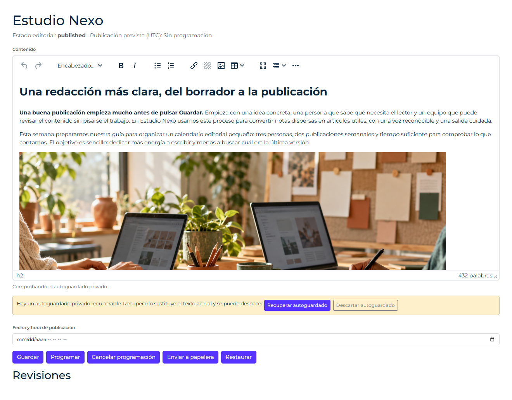

# Autoguardado privado en el servidor



*El artículo guardado convive con una copia privada recuperable. El aviso permite recuperar o descartar esa copia; su existencia no significa que el contenido se haya publicado. Captura de GFrame 4.3.1.*

El módulo optativo `content-autosave` guarda una copia privada del texto mientras se escribe. La vincula al usuario, al tenant activo cuando existe y a una clave de contenido/campo. No crea otro artículo ni modifica su versión pública. La publicación continúa en el formulario de la aplicación.

Para impedir que Guardar/Publicar sobrescriba otra edición, adopte [el guardado por revisión](content-editing.md). Use la revisión del modelo también como `base_version` del autoguardado; la copia privada conserva su control de versión independiente.

## Instalar y actualizar

Añada `content-autosave` a la lista completa de módulos instalados mediante [el actualizador](modulos-opcionales.md#añadir-módulos-a-un-proyecto-instalado), primero con `--dry-run` y la política de personalizaciones habitual. Se resuelven `self-account` y `rich-text-editor` y se instala la tabla `content_autosaves` en MySQL o SQLite. Publicar únicamente assets no instala la tabla. No necesita modificar la tabla de artículos.

Las instalaciones que ya usaban el editor pueden conservarlo sin autoguardado remoto. Para activar esta función deben instalar el módulo, añadir su ruta autorizada y configurar el campo. No se modifican sitios existentes automáticamente.

## Ruta autorizada de la aplicación

El framework no define artículos, permisos editoriales ni una ruta genérica para escribir tablas. Declare una ruta POST propia, protegida con `auth`, el permiso de edición correspondiente y CSRF normal del Router. Por ejemplo, en `config/routes/routes_ajax_admin_articles.php`, utilizando un permiso registrado por su aplicación:

```php
RouteBuilder::post('ajax/admin/articles/autosave', 'articles/ArticleController@autosave')
    ->middleware(['auth', 'can:articles.edit'])->registerFinal();
```

En `autosave()`, cargue el registro solicitado con el modelo de la aplicación y compruebe que ese usuario puede editar **ese registro y su tenant**, igual que en Guardar/Publicar. Rechace los registros inexistentes/no autorizados antes de delegar. Tras obtener el artículo autorizado:

```php
$revision = hash('sha256', $article['content']);
return (new \GFrame\Content\ContentDraftController())->handle(
    'article:' . (int)$article['id'] . ':content',
    $revision
);
```

La clave y la revisión actual se calculan en el servidor; nunca se toman directamente de POST. Puede usar una revisión de su modelo en vez del hash, hasta 128 bytes. Si necesita consistencia estricta entre una publicación concurrente y la lectura de esa revisión, mantenga la comprobación y la delegación dentro de la transacción/bloqueo de su modelo. El servicio no bloquea tablas de negocio que desconoce.

El controlador auxiliar toma el usuario de `$_SESSION['auth']['id']`, verifica el tenant activo y rechaza contradicciones con la petición. Ignora identidades o claves de recurso enviadas por el navegador. No sustituye la autorización del registro ni el middleware de la ruta. Solo acepta `load`, `save` y `discard`, y no admite nombres de tablas/columnas ni handlers.

## Configurar el campo

Use los recursos del editor y `alerts` para confirmar descartes, normalmente cargados por el panel estándar. En plantillas propias puede usar `richTextEditorRecovery.meta.php` como se explica en [protección y recuperación](rich-text-editor.md#protección-y-recuperación).

```php
$richTextEditor = [
    'id' => 'article-content', 'name' => 'content', 'label' => 'Contenido',
    'value' => $article['content'],
    'draft_key' => $localDraftScope,
    'autosave' => [
        'url' => site_url . 'ajax/admin/articles/autosave?article_id=' . (int)$article['id'],
        'base_version' => hash('sha256', $article['content']),
        'interval' => 15000,
    ],
];
include \GFrame\Modules\ModuleRuntime::file(
    'views', 'rich-text-editor/richTextEditor.php', 'rich-text-editor'
);
```

`url` debe ser del mismo origen y corresponder a su ruta autorizada. El controlador de la aplicación debe validar el identificador de la URL y cargar el artículo; ese ID por sí solo no autoriza nada. `base_version` es la misma revisión pública que el endpoint vuelve a calcular. `interval` está en milisegundos: 15000 por defecto, mínimo 5000 y máximo 120000. Se espera una pausa de un segundo tras editar y se respeta el intervalo entre lanzamientos. Solo hay una petición activa por editor. No se usa cron.

El cliente envía los tokens de `#tokens`, la acción, la versión privada conocida, la revisión pública esperada y el HTML del campo. La ruta devuelve el contrato `status`, `code`, `message`, `data`. Los fallos temporales se reintentan hasta tres intentos; después puede pulsar **Comprobar autoguardado**. Conflictos y rechazos de autorización no se reintentan automáticamente. El texto permanece en el editor y la recuperación local continúa cuando `draft_key` está habilitada. Read-only y destrucción detienen nuevos envíos; una petición ya recibida por el servidor puede terminar de guardar su copia privada.

## Recuperación y publicación

Al cargar la página se consulta la copia privada. Si contiene cambios, se ofrecen **Recuperar autoguardado** y **Descartar autoguardado**; no se sustituye automáticamente la versión pública ni lo que se está escribiendo. Recuperar admite Deshacer; descartar requiere confirmación. Si la copia procede de una revisión pública anterior se advierte antes de recuperarla. Las copias locales y del servidor se ofrecen por separado.

El autoguardado no llama a `markSaved()` ni elimina el aviso de cambios sin publicar. Para Guardar/Publicar capture el snapshot antes del envío, persista mediante su flujo normal y devuelva la nueva revisión del contenido realmente guardado. Confírmela así:

```javascript
// snapshot se capturó antes del envío; response indica éxito de negocio.
window.AdminRichTextEditor.markSaved(snapshot, response.data.revision);
```

La nueva revisión debe usar la misma regla que `base_version`. El editor espera la petición privada activa y descarta condicionalmente la versión conocida; después autoguarda las ediciones posteriores al snapshot usando la nueva revisión. Si otra pestaña cambió la copia, se informa del conflicto y no se borra a ciegas. Si omite la nueva revisión, el autoguardado se pausa hasta recargar, conservando el guardado confirmado y evitando escribir con una revisión antigua. El orden de las publicaciones de negocio sigue siendo responsabilidad de la aplicación.

## Almacenamiento y límites

Hay una fila por usuario/tenant/recurso, identificada por un hash de esas identidades, y una versión opaca nueva en cada escritura. La actualización compara la versión anterior en el mismo UPDATE; dos peticiones con la misma versión no pueden ganar ambas. El descarte conserva un tombstone versionado para que una petición antigua no resucite una copia descartada.

Se admite hasta 1 MiB de HTML recibido y se aplica `HtmlSanitizer` antes de persistir. El navegador conserva sus ediciones mientras llega la respuesta; nunca las reemplaza con una respuesta antigua. Cada copia caduca a los 30 días: se deja de ofrecer su contenido, pero se conserva su versión para coordinar escrituras. El módulo no purga físicamente filas ni implementa un historial de revisiones; la política de retención/borrado de cuentas y contenido pertenece a la aplicación. El tamaño de la base de datos debe contemplar esas filas.

La copia protege únicamente este campo, no el título ni otros datos del formulario. No es colaboración en tiempo real, no evita conflictos de publicación fuera de su flujo de negocio y no garantiza salvar lo escrito después del último autoguardado confirmado si desaparecen tanto el navegador como su copia local.
