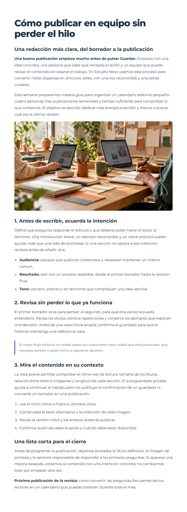

# Vista previa privada del sitio



*El borrador se presenta con estilos de lectura propios del ejemplo: anchura contenida, títulos, espaciado, listas y cita. La plantilla pertenece al proyecto; abrirla no publica el contenido ni aplica estos estilos a todo el core. Captura de GFrame 4.3.1.*

Instale el módulo optativo `content-preview` mediante [el actualizador](modulos-opcionales.md#añadir-módulos-a-un-proyecto-instalado), primero con `--dry-run`. Reutiliza `content-autosave` y su tabla; no instala artículos ni publica contenido.

## Rutas y plantilla

Declare dos rutas GET web propias con sesión, `auth` y su permiso de edición: página de preview y estado JSON. Ambas cargan y autorizan de nuevo el registro y tenant antes de delegar. No utilice `noSession()`. Los nombres de rutas y controladores pertenecen al proyecto; no se distribuye un endpoint universal.

En el controlador de preview, antes de cualquier HTML:

```php
$preview = (new \GFrame\Content\ContentPreviewController())->read(
    'article:' . (int)$article['id'] . ':content',
    $article['revision'], $article['content']
);
if ($preview['status'] !== 'success') return $preview;
$article['content'] = $preview['data']['content'];
```

Use exactamente el recurso y revisión del autoguardado. Renderice después la misma vista/plantilla pública del artículo, pasando `$article` y `$preview` según el contrato de Render de su proyecto. El helper solo selecciona el contenido; la aplicación sigue siendo responsable de renderizarlo y autorizarlo.

Una copia disponible con `base_version` actual sustituye el HTML del campo. Si no existe o pertenece a otra revisión, se usa el contenido actual autorizado. No se borra la copia antigua. No se previsualiza automáticamente el título, slug ni relaciones pendientes: el autoguardado existente cubre un campo HTML.

La lectura exige sesión activa con identidad, resuelve tenant desde el servidor y aplica `Cache-Control: private, no-store`, `X-Robots-Tag: noindex, nofollow, noarchive` y `Vary: Cookie`. Si las cabeceras ya se enviaron se rechaza la operación. Excluya estas rutas de cachés compartidas y preserve el canonical público en los metadatos de la plantilla.

En la ruta de estado, vuelva a cargar y autorizar el artículo:

```php
$state = (new \GFrame\Content\ContentPreviewController())->state(
    'article:' . (int)$article['id'] . ':content',
    $article['revision'], $article['content']
);
header('Content-Type: application/json; charset=utf-8');
echo json_encode($state, JSON_THROW_ON_ERROR);
```

El canal web no serializa arrays automáticamente como AJAX. Use su respuesta JSON habitual si la aplicación ya la tiene. El estado no devuelve HTML, solo una versión opaca e indicador de copia privada. Los guardados mantienen POST y CSRF; estas lecturas no escriben datos.

## Actualización automática

Combine en el meta de esa vista pública sus recursos habituales con `content-preview/preview.meta.php`, mediante `ModuleRuntime::file('views', ..., 'content-preview')`. Añade `public/js/app/admin/components/content-preview.js`. Dentro de la vista incluya:

```php
$contentPreview = [
    'state_url' => site_url . 'articles/preview-state/' . (int)$article['id'],
    'version' => $preview['data']['version'],
];
include \GFrame\Modules\ModuleRuntime::file(
    'views', 'content-preview/preview.php', 'content-preview'
);
```

El componente comprueba el estado cada tres segundos, con una petición activa y timeout de diez segundos. Si cambia la versión confirmada, recarga la plantilla completa. La pestaña oculta pausa nuevas consultas; al volver comprueba otra vez. Error, 403, redirección o pérdida de sesión detienen la actualización y muestran aviso, sin bucle a login. Use `ContentPreview.mount(root)` para HTML dinámico y destruya la instancia antes de retirarlo.

## Botón del editor

```php
$richTextEditor['preview_url'] = site_url . 'articles/preview/' . (int)$article['id'];
```

**Más herramientas → Vista previa del sitio** abre una pestaña del mismo origen. Una URL externa se rechaza. El botón no publica, no fuerza un guardado ni confirma snapshots: muestra lo que el autoguardado o el guardado normal hayan persistido. Se conserva el intervalo del autoguardado, sin prometer actualización por cada pulsación.

La preview nativa de TinyMCE se retira de los plugins y controles predeterminados. Sin `preview_url` no se ofrece una preview que simule la plantilla pública. Overrides personalizados pueden añadir el plugin nativo explícitamente; revíselos al actualizar. La barra pública de administración queda aplazada.
