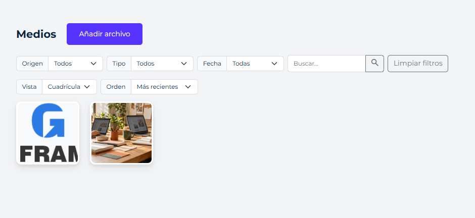
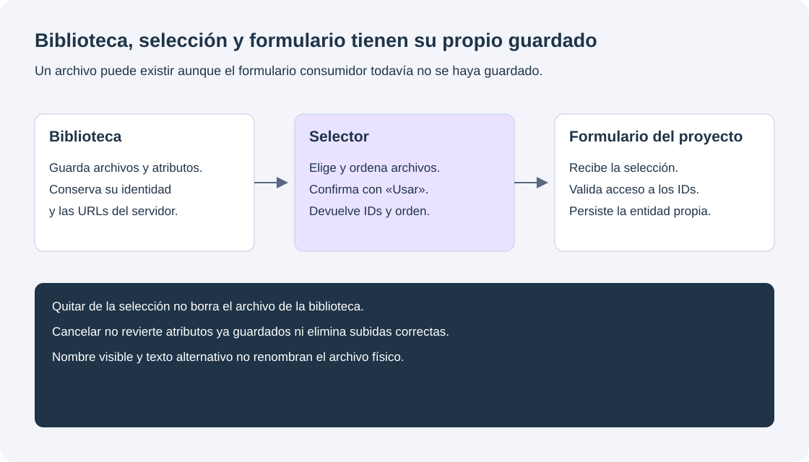
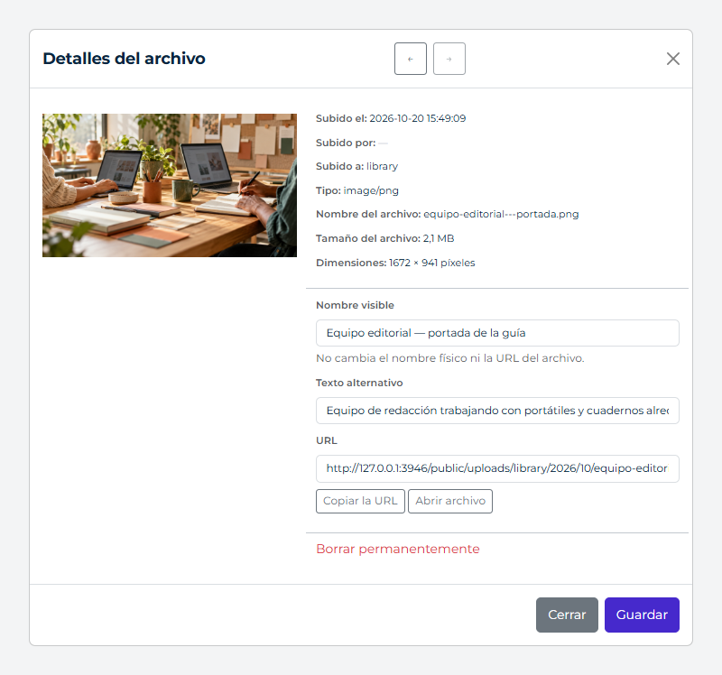

# Biblioteca multimedia



*La biblioteca reúne la portada editorial y los recursos de marca. Los filtros y las vistas permiten encontrar y reutilizar archivos sin volver a subirlos. Captura de GFrame 4.3.1.*

`media-library` instala una biblioteca de archivos con listado, búsqueda, carga, eliminación y campos reutilizables. Puede operar de forma global, por tenant o por usuario.

## Instalación

Incluye el módulo en el perfil del instalador o publícalo mediante el catálogo de módulos. El controlador y las vistas originales permanecen en `resources/modules/media-library/application/app/`, dentro del paquete. Se publican las rutas, los componentes de inclusión, los recursos públicos y el esquema de MySQL o SQLite; se crean carpetas vacías de personalización en `app/controllers/media-library` y `app/views/media-library`, las capas presentes en el módulo.

Las rutas declaran `->module('media-library')`. Primero se busca en `app` y después en el módulo, sin duplicar archivos. El controlador nativo es `GFrame\Modules\MediaLibrary\Controllers\MediaController`; puede extenderse desde un controlador del proyecto. Las vistas personalizadas usan el mismo nombre relativo que las nativas. Un archivo personalizado no se sobrescribe al actualizar.

El módulo depende de `self-account`, `alerts` y `frontend-core`.

## Consultar y editar archivos

En `admin/media`, elige **Cuadrícula** o **Lista**. La lista muestra nombre visible, nombre físico, MIME, tamaño, autor registrado y fecha. Ambas vistas conservan búsqueda, origen, tipo y mes. El orden admite incorporación reciente o antigua, nombre visible A–Z/Z–A y tamaño; por defecto se mantiene la incorporación más reciente. «Limpiar filtros» restablece filtros y orden, conservando la vista elegida.

La URL conserva `view=list`, `sort`, filtros y página, por lo que puede copiarse o recuperarse con Atrás/Adelante. Valores de `sort`: `newest`, `oldest`, `name_asc`, `name_desc`, `size_asc`, `size_desc`. Un valor desconocido vuelve a `newest`; los empates por nombre o tamaño se resuelven por ID descendente. El servicio `paginate()` acepta estas claves en su arreglo de filtros y devuelve el estado normalizado en `meta`. Los adaptadores de `MediaRepository` personalizados deben implementar ese orden para ofrecer el mismo comportamiento.

Abre un archivo para consultar sus detalles. **Anterior** y **Siguiente** recorren el resultado filtrado, también entre páginas; se desactivan en los extremos. **Nombre visible** modifica `original_name`, sin renombrar el archivo físico ni cambiar enlaces. **Texto alternativo** modifica `alt_text`. Guardar mantiene los detalles abiertos; para abandonar una edición pendiente debes guardar o descartar sus cambios. Un fallo conserva los valores para poder reintentar.

Los audios y vídeos usan controles nativos del navegador, sin reproducción automática; al cambiar de archivo o cerrar se libera el reproductor. **Abrir archivo** abre su URL en otra pestaña. La reproducción depende del formato y los códecs del navegador y del servidor remoto, si corresponde. No se implementa un proxy ni se garantiza descarga forzada de recursos externos. Las URLs locales siguen siendo públicas según el almacenamiento del módulo.

Estas mejoras no requieren migración de base de datos ni nuevos permisos. Al actualizar, publica los recursos del módulo mediante el actualizador y revisa overrides de `_mlist.php`, `mediaEditModal.php` y controladores personalizados: los overrides del proyecto tienen prioridad sobre las vistas nativas. La lista usa el nuevo fragmento `_table.php`. El selector conserva su cuadrícula y sus modos simple/múltiple.

## Configuración

```php
'media' => [
    'scope' => 'global',
    'quota_bytes' => 0,
],
```

`scope` admite `global`, `tenant` o `user`. En ámbitos no globales, `MediaScopeResolver` obtiene el identificador desde la sesión normalizada. `quota_bytes` limita el consumo total del ámbito; `0` lo deja sin límite. Estos dos valores describen la integración del proyecto, no el procesamiento de los archivos.

### Elegir la biblioteca y su propietario

| Ámbito | Biblioteca compartida por | Identidad utilizada |
| --- | --- | --- |
| `global` | Todos los usuarios autorizados del proyecto | Sin ID de propietario |
| `user` | El usuario conectado | `$_SESSION['auth']['id']` |
| `tenant` | Miembros autorizados del tenant activo | Clave de sesión indicada por `tenancy.key`, o `tenant_id` |

El ámbito describe propiedad del almacenamiento, no quién tiene permiso para subir o borrar. La aplicación establece el tenant activo en sesión después de comprobar su acceso; el resolver no comprueba la membresía ni selecciona un tenant desde POST. Si falta la identidad de un ámbito user o tenant, falla sin utilizar la biblioteca global como respaldo.

Las llamadas PHP al servicio aceptan un `MediaScope` explícito. Si lo omites utilizan `global`, aunque la configuración diga `tenant`: pasa el ámbito en todas las integraciones propias.

Los tipos, límites por archivo y tamaños pertenecen al módulo: `resources/modules/media-library/config/media.php`. No se modifica esa copia instalada para personalizar un proyecto. Sus valores predeterminados son 25 MB, los formatos seguros habituales, `small` de 150×150 recortado y `medium` de hasta 300×300 proporcional. Se conserva el original intacto; no se genera `optimized` ni se amplían imágenes pequeñas. Las claves de compatibilidad de las miniaturas pueden referirse a un mismo archivo, sin generar copias adicionales.

La personalización se realiza por herencia, por ejemplo en `app/services/media-library/ProjectMediaProcessor.php`:

```php
<?php
namespace App\Services\MediaLibrary;

class ProjectMediaProcessor extends \GFrame\Media\MediaProcessor
{
    protected function configuration(): array
    {
        $config = parent::configuration();
        $config['max_upload_bytes'] = 10 * 1024 * 1024;
        $config['allowed_extensions'] = ['images' => ['jpg', 'jpeg', 'png', 'webp']];
        $config['variants'] = [
            'small' => ['w' => 150, 'h' => 150, 'mode' => 'crop'],
            'banner' => ['w' => 1200, 'h' => 600, 'mode' => 'fit'],
        ];
        return $config;
    }
}
```

El controlador del proyecto, en `app/controllers/media-library/MediaController.php`, conecta el procesador sin cambiar las rutas ni el controlador nativo:

```php
<?php
namespace App\Controllers\MediaLibrary;

class MediaController extends \GFrame\Modules\MediaLibrary\Controllers\MediaController
{
    protected function createProcessor(): \GFrame\Media\MediaProcessor
    {
        return new \App\Services\MediaLibrary\ProjectMediaProcessor();
    }
}
```

La clase del servicio debe estar registrada en el autoload del proyecto o incluida explícitamente; no se carga automáticamente por estar en una carpeta. El mismo procesador se utiliza en biblioteca, selector y sincronización. Las integraciones PHP externas deben inyectar la misma subclase en su servicio. Omitir una variante la desactiva; `variants => []` conserva solo el original. Los formatos configurados se intersectan con los formatos seguros soportados; esta configuración no habilita PHP, HTML ni otros ejecutables. Añadir un formato realmente nuevo requiere ampliar la validación por herencia, no solo cambiar su extensión.

Los cambios afectan únicamente a archivos nuevos. No se borran ni regeneran los tamaños existentes. `media.max_upload_bytes` de la antigua configuración del proyecto ya no define el límite: ahora lo define el procesador del módulo, y el backend lo comunica a los selectores.

El límite efectivo también depende de PHP (`upload_max_filesize`, `post_max_size`) y del servidor web. Aumentar el valor del procesador no aumenta esos límites.

### Organización del almacenamiento

El controlador utiliza `public` como raíz de MediaStorage:

```text
public/uploads/<source>/<año>/<mes>/                  global
public/uploads/user/<id>/<source>/<año>/<mes>/        usuario
public/uploads/tenant/<id>/<source>/<año>/<mes>/      tenant
```

`source` identifica el origen funcional, como `library` o `articles`; no crea otro ámbito de seguridad. Cada publicación guarda sus selecciones en su propia tabla.

El aislamiento del listado no convierte los archivos en privados: están en `public` y pueden servirse directamente por URL. Para documentos confidenciales utiliza almacenamiento protegido y una descarga autorizada del proyecto; un enlace difícil de adivinar no sustituye esa protección.

## Permisos

- `media.view`: abrir y consultar la biblioteca.
- `media.add`: cargar archivos.
- `media.delete`: eliminar archivos.
- `media.edit`: editar nombre y texto alternativo.
- `media.sync`: incorporar archivos válidos existentes en disco.

El superadministrador conserva acceso por la jerarquía general de permisos. Los demás roles deben recibir los permisos necesarios.

## Uso administrativo

### Rutas y campos HTTP

La pantalla es `GET admin/media`. Estas acciones son POST bajo `ajax/admin/media/`, con autenticación, la capacidad correspondiente y CSRF:

| Acción | Campos principales | Capacidad |
| --- | --- | --- |
| `list` | `q`, `source`, `kind`, `ym`, `page`, `fragment` | `media.view` |
| `field` | `media_ids`, `variant`, `allow_remove_one` | `media.view` |
| `upload` | Archivo multipart `file`, `source` | `media.add` |
| `hotlink` | `media_url`, `name`, `source` | `media.add` |
| `base64` | `base64`, `name` | `media.add` |
| `details` | `media_id` | `media.view` |
| `save` | `media_id`, `original_name`, `alt_text` | `media.edit` |
| `delete` | `media_id` | `media.delete` |
| `quota` | Ámbito resuelto en el servidor | `media.view` |
| `sync` | Ámbito resuelto en el servidor | `media.sync` |

`fragment` del listado admite `library` o `picker`. No aceptes un nombre arbitrario de archivo PHP como fragmento.

`MediaLibrary` envía el fragmento según su modo: `manage` usa `library` y `picker` usa `picker`. El listado principal conserva sus IDs históricos; el selector utiliza el prefijo `mp-`, incluidos filtros, tarjetas y paginación. Los filtros se identifican también mediante `data-ml-filter` y las acciones mediante `data-ml-action`. La paginación de cada listado se controla desde su propia instancia, sin depender de cuál haya quedado activa globalmente. Mantenga esos atributos y el contenedor `data-ml-pagination` al personalizar `_mlist.php`; utilice `data-media-id` para obtener el ID del archivo, sin extraerlo del ID del nodo DOM. Incluya el modal del selector una sola vez por página.

La página `admin/media` incluye biblioteca, filtros por origen, tipo y mes, búsqueda automática, carga y modal de detalles con texto alternativo, URL copiable y eliminación. El selector conserva las pestañas Biblioteca, Subir y Desde URL. Los tipos canónicos son `images`, `videos`, `audios` y `docs`. La cuota y la sincronización siguen disponibles mediante el servicio y sus rutas; esta vista original no añade controles nuevos para ellas ni muestra navegación anterior/siguiente.

El campo reutilizable se incluye desde `app/views/components/media/mediaField.php`. El selector requiere también `mediaPicker.php` una sola vez en la vista o plantilla que aloje el modal. Admite selección simple o múltiple, filtro por tipo, búsqueda, paginación, carga desde el modal y conservación de la selección entre páginas. Las vistas previas se obtienen como HTML del servidor; nunca se construyen con rutas enviadas por el navegador.

### Subir y preparar la selección

Guardar un archivo en la biblioteca, confirmar una selección y guardar el registro de negocio son tres operaciones distintas. Completar una no confirma automáticamente las otras.



*El selector devuelve los IDs y su orden. El formulario del proyecto valida su acceso y los persiste; editar atributos modifica la biblioteca, no solamente una selección provisional. Esquema de GFrame 4.3.1.*

La subida muestra progreso y resultado por archivo tanto en la biblioteca principal como en el selector. El porcentaje mide la transferencia: al terminar puede aparecer «Procesando…» hasta que el servidor confirme el guardado. Un error de un archivo no descarta los demás.

En el selector, las subidas correctas quedan seleccionadas sin cerrar el modal. En selección simple se elige el último archivo válido del lote, según el orden de entrada; en selección múltiple se añaden en ese orden, conservando la selección anterior y respetando el máximo. Los archivos que excedan el máximo pueden quedar guardados en la biblioteca, pero no seleccionados; el modal lo indica. «Desde URL» conserva su significado de enlace externo y usa el mismo flujo de selección tras el registro.

Cerrar y reabrir el selector no incorpora las selecciones de una subida anterior que termine tarde. Los archivos que ya se subieron no se borran al cancelar la selección. Una subida correcta no guarda por sí sola el formulario que utiliza el campo: confirme con «Usar» y guarde el formulario.

### Consultar y editar atributos desde el selector



*Panel nativo de detalles de la biblioteca, con atributos guardados en una aplicación temporal. Ilustra los datos del archivo; el selector dispone de su propio panel dentro del modal. Captura de GFrame 4.3.1.*

| Acción | Qué modifica | Qué conserva |
| --- | --- | --- |
| Guardar nombre visible o texto alternativo | Atributos en la biblioteca | Archivo físico y URL |
| Quitar de la selección | Composición elegida | Archivo almacenado |
| Reordenar la selección | Orden de los IDs devueltos | Contenido de cada archivo |
| Confirmar con «Usar» | Resultado entregado al campo | No guarda por sí solo la entidad del proyecto |
| Cancelar | Descarta la composición provisional | No revierte atributos guardados ni borra subidas correctas |

Al seleccionar un archivo se consultan sus detalles en el mismo modal. El nombre visible y el texto alternativo de una imagen pueden guardarse mediante las rutas existentes; se mantienen `media.edit`, CSRF y el ámbito del servidor. Un permiso de consulta no concede permiso de edición y el rechazo de guardado se informa sin aplicar cambios locales como si se hubieran guardado.

«Nombre visible» no renombra el archivo físico ni cambia su URL. El texto alternativo describe la imagen y puede quedar vacío si es decorativa. Las leyendas y descripciones ampliadas no se incorporan en esta entrega.

Guarde o descarte los cambios de atributos antes de cambiar de archivo, confirmar o cerrar el modal. Guardar atributos modifica los datos de la biblioteca; cancelar después la selección no revierte ese guardado. El panel no añade campos a la serialización del formulario consumidor ni impide su validación cuando el modal está cerrado.

Una respuesta nativa de guardado correcto conserva `status`, `code` y `message` y añade `data` con el archivo guardado, sus atributos normalizados y sus URL del servidor. El selector utiliza esos datos para actualizar la selección y las vistas sin tratar el texto del navegador como resultado definitivo del guardado.

### Revisar y ordenar imágenes seleccionadas

En selección múltiple, «Archivos seleccionados» muestra la composición completa, incluidos archivos elegidos en otras páginas. Los botones anterior/siguiente cambian su orden; «Quitar» retira el archivo de esta selección y no lo borra. Los controles funcionan con teclado. Al volver a abrir un campo, conserva sus IDs y el orden guardado.

El resultado de `MediaPicker.open()` añade `replaceSelection`. Vale `true` cuando el usuario quita o reordena explícitamente la composición. `MediaField` aplica entonces el resultado completo, incluso si su comportamiento habitual es `append`. Sin esa edición explícita, `append` conserva la combinación anterior y `replace` sigue sustituyendo la selección. Los consumidores directos deben guardar los IDs en el orden devuelto y validar su acceso en backend.

Esta composición de IDs no añade un constructor de páginas ni opciones de presentación de galerías dentro del texto.

En una vista que no sea la biblioteca, registra los recursos en su meta, después incluye los componentes:

```php
// En el meta de la vista, además de Bootstrap, jQuery y alertas:
'css' => ['public/css/modules/media-library/media-library.css'],
'js' => [
    'public/js/modules/media-library/media-library.js',
    'public/js/modules/media-library/media-picker.js',
    'public/js/modules/media-library/media-field.js',
],
```

```php
<?php
$mediaField = [
    'name' => 'gallery_ids',
    'label' => 'Galería',
    'value' => [12, 18],
    'multiple' => true,
    'max' => 12,
    'accept' => 'images',
    'behavior' => 'append',
    'save_source' => 'library',
    'fragment' => 'gthumb',
    'remove_one' => true,
];
include ABSPATH . 'app/views/components/media/mediaField.php';
include ABSPATH . 'app/views/components/media/mediaPicker.php';
?>
```

Un campo simple guarda un ID entero o una cadena vacía. Un campo múltiple guarda un arreglo JSON de IDs en su input; al recibirlo, el controlador de la aplicación debe validarlo y aplicar sus reglas de relación con el contenido. `max` admite de 1 a 50. `behavior` admite `append` o `replace`. `fragment` solo admite `sthumb` y `gthumb`. El ámbito `tenant` o `user` se toma de la sesión normalizada, no de un ID enviado por el navegador.

El campo nativo presenta las miniaturas encima de los botones Elegir imagen (o Elegir archivo) y Quitar. Las miniaturas muestran el puntero de mano y abren el selector mediante clic, Enter o espacio. En una galería, Quitar bajo cada miniatura retira solo ese elemento y el botón general vacía la selección. Estas acciones no borran archivos de la biblioteca.

Si no se especifica `fragment`, el campo simple utiliza `sthumb` y la galería utiliza `gthumb`, que incluye el control de retirada individual cuando `remove_one` está habilitado.

Para contenido insertado después de cargar la página, llama a `MediaField.bindAll(contenedor)`. Si se integra el selector directamente, `MediaPicker.open({selected, multiple, max, kind, saveSource})` devuelve una promesa con `{ids, items}` o `null` cuando se cancela. El componente necesita las rutas AJAX del módulo y el formulario global `#tokens`.

La biblioteca expone `window.MediaLibrary`. La pantalla administrativa la inicia mediante `media-admin.js`; otras integraciones pueden usar `new MediaLibrary({mount, uiRoot, mode, syncUrlEnabled, saveSource, kind, uploadMaxMB, endpoints})`. El fragmento PHP reemplaza el contenido del contenedor asignado; no se construyen tarjetas en JavaScript.

`MediaPicker.open({selected, multiple, max, kind, saveSource, endpoints})` admite `endpoints: {list: URL, upload: URL, details: URL, save: URL, field: URL}`. Las claves son opcionales y conservan sus rutas nativas bajo `ajax/admin/media/`. Esto permite usar el mismo selector en otros formularios con rutas propias; no elige una vista ni cambia el propietario de la biblioteca. Los endpoints personalizados de detalles, guardado y bandeja deben mantener los mismos contratos si se sustituyen. El campo acepta `data-ml-field-endpoint` para su vista previa. Todas las rutas alternativas deben conservar permisos, tokens y resolución del ámbito en el servidor.

El listado acepta `q`, `source`, `kind`, `ym` y `page`; devuelve `status`, `code`, `data`, `meta` y `html`. La vista previa recibe `media_ids`, `variant` y `allow_remove_one`; recupera los archivos por ID bajo el ámbito activo. El backend construye las URL de los archivos y miniaturas; no acepta rutas de archivo aportadas por el navegador.

El selector utiliza además `variant=selection` en el endpoint `field` para renderizar su bandeja mediante el fragmento PHP `_selection.php`, con el mismo máximo de 50 IDs y filtro por ámbito. Este fragmento no es una variante de imagen ni una opción de miniatura de `MediaField`; sus variantes siguen siendo `sthumb` y `gthumb`. Los listados descartan respuestas anteriores cuando una consulta más reciente ya está en curso.

## Uso desde PHP

```php
use GFrame\Media\MediaLibraryService;
use GFrame\Media\MediaModel;
use GFrame\Media\MediaScope;
use GFrame\Media\MediaStorage;
use GFrame\Media\MediaScopeResolver;

$media = new MediaLibraryService(
    new MediaModel(),
    new MediaStorage(ABSPATH . 'public')
);

$scope = (new MediaScopeResolver())->resolve();
$identity = (array)($_SESSION['auth'] ?? []);
$uploader = ['id' => (int)($identity['id'] ?? 0), 'name' => (string)($identity['name'] ?? $identity['email'] ?? '')];

$result = $media->registerLocalFile(
    $temporaryPath,
    $originalName,
    'library',
    $scope,
    $uploader
);

$generated = $media->ingestBase64($base64, 'imagen-generada.png', $scope, $uploader);
$remote = $media->registerRemoteUrl('https://ejemplo.com/imagen.jpg', 'Imagen externa', 'library', $scope, $uploader);
$details = $media->details($mediaID, $scope);
$media->updateMetadata($mediaID, [
    'original_name' => 'Portada principal',
    'alt_text' => 'Descripción accesible de la portada',
], $scope);
$quota = $media->quota($scope);
```

Las operaciones devuelven un arreglo estable con `status` y `code`. Cuando corresponde, incluyen `message`, `data` o `meta`. La capa que llama decide si muestra una vista de error, `swalAlert` o `alertToast`.

```php
if (($result['status'] ?? 'error') === 'success') {
    $mediaID = (int)$result['data']['media_id'];
}
```

## Guardar imágenes y galerías

Para insertarlas dentro del texto con TinyMCE, consulta [la integración opcional de escritura](rich-text-media.md). Los campos de imagen/galería de un CRUD siguen guardando sus IDs como se indica a continuación; la integración de escritura conserva HTML semántico en el campo de contenido de la aplicación.

Cada CRUD guarda el ID de la imagen en su propia tabla. Para una galería, guarda un arreglo JSON de IDs cuyo orden determina el orden de las imágenes. Las variantes disponibles pertenecen al registro del archivo; la vista elige el tamaño que necesita.

Sustituir o quitar una selección modifica únicamente el campo del contenido y conserva el archivo en la biblioteca. No hace falta una tabla auxiliar de relaciones. Antes de guardar, valida cada ID con `details($id, $scope)` y comprueba los permisos sobre el contenido.

`delete()` elimina el registro y sus archivos locales y variantes. El módulo no rastrea dónde se usa cada archivo ni bloquea el borrado de archivos seleccionados por un CRUD. Los enlaces remotos se retiran de la biblioteca sin borrar el recurso del servidor externo.

## Extensión

Para usar otro origen de datos, implementa `GFrame\Media\Contracts\MediaRepository` e inyéctalo en `MediaLibraryService`. El adaptador debe aplicar siempre `MediaScope` al buscar, listar y eliminar archivos.

Los orígenes se normalizan a un identificador seguro y forman parte de la ruta de almacenamiento. No deben usarse rutas proporcionadas directamente por el usuario.

`MediaSyncService` recorre únicamente la carpeta del ámbito indicado, ignora variantes y extensiones bloqueadas, valida el contenido y registra originales ausentes en la base de datos.

## Validación y seguridad

- Se bloquean extensiones ejecutables y de marcado activo.
- La extensión debe estar en la lista permitida de su tipo.
- Las imágenes se validan por su contenido y dimensiones.
- Los demás archivos se validan por MIME; audio y video genéricos `application/octet-stream` se rechazan.
- El tamaño máximo se comprueba antes de copiar el archivo.
- La cuota se comprueba con el original y las variantes generadas.
- Las imágenes generan variantes optimizadas cuando GD ofrece el formato necesario.
- Las rutas se generan dentro del almacenamiento configurado.
- Las rutas administrativas exigen autenticación y permiso específico.
- Los enlaces externos solo admiten HTTPS con DNS público, certificado válido, puerto 443, respuesta directa 2xx y MIME/extensión permitidos. No se siguen redirecciones. La URL queda en `remote_url`; `path` es una clave interna única y no se usa como ruta física. El archivo externo no consume cuota local ni se borra del servidor remoto al quitar su registro.

## Códigos principales

Éxito: `media_created`, `media_loaded`, `media_deleted`, `media_updated`, `media_details_loaded`, `media_quota_loaded` y `media_synchronized`.

Errores esperados: `file_not_found`, `file_size_not_allowed`, `media_quota_exceeded`, `extension_not_allowed`, `media_not_allowed`, `mime_not_allowed`, `not_image`, `extension_mime_mismatch`, `invalid_base64_media`, `media_not_found` y `media_scope_invalid`.

Fallos internos: `media_create_failed`, `media_list_failed`, `media_details_failed`, `media_update_failed`, `media_delete_failed`, `media_quota_failed` y `media_sync_failed`.

Los fragmentos rechazan variantes fuera de la lista permitida con `invalid_media_fragment` y selecciones excesivas con `invalid_media_selection`. Cada vista previa se obtiene por ID bajo el ámbito activo; los archivos de otro tenant o usuario no se devuelven.

## Autoría, búsqueda y archivos remotos

La URL remota se persiste separada de la clave interna. Se rechazan HTTP y redirecciones remotas para proteger las consultas del servidor. El controlador toma el autor de la sesión y el servicio lo guarda como `metadata.uploader` (ID y nombre al subir); no confía en `uploaded_by` enviado desde el navegador. Las cargas, enlaces y archivos base64 registran ese dato. Integraciones PHP pasan el autor explícitamente; una sincronización o archivo antiguo sin autor muestra «—». No se inventa el autor de archivos anteriores. «Subido a» muestra el origen. La búsqueda incluye nombre, nombre original y `alt_text`, que corresponde al «Título descriptivo».

Las instalaciones antiguas pueden conservar vistas o controladores publicados en `app`; al tener prioridad sobre el módulo, deben revisarse explícitamente antes de retirarlos. La actualización no elimina personalizaciones ni modifica automáticamente archivos antiguos.

## Actualización del esquema

Las instalaciones nuevas reciben todas las columnas desde los esquemas del módulo. Las actualizaciones aplican las migraciones de metadatos y de `remote_url` mediante el actualizador del proyecto. Desde 3.0.0, una migración elimina la tabla auxiliar `media_relations`, sin eliminar archivos ni modificar los IDs guardados en las tablas de contenido. Antes de actualizar, consulta [la transición a 3.0.0](release-3.0.0.md). Revisa los cambios con `composer gframe:update -- --dry-run` y verifica la aplicación después de aplicarlos.

## Validar el campo al guardar un formulario

El navegador envía IDs, no archivos completos ni rutas. Para un campo múltiple:

```php
<?php
$raw = (string)($_POST['gallery_ids'] ?? '[]');
$ids = json_decode($raw, true);
if (!is_array($ids) || !array_is_list($ids) || count($ids) > 12) {
    return ['status' => 'error', 'code' => 'invalid_gallery'];
}
foreach ($ids as $id) {
    if (!is_int($id) || $id <= 0) {
        return ['status' => 'error', 'code' => 'invalid_gallery'];
    }
}
$ids = array_values(array_unique($ids));
// Valida cada archivo con details($id, $scope) antes de guardar sus IDs.
return ['status' => 'success', 'data' => ['ids' => $ids]];
```

La aceptación del selector en el navegador no autoriza esos IDs. En el backend comprueba también el ámbito, tipo permitido y acceso al contenido que recibe la galería. Un campo simple requiere validar un ID positivo o un valor vacío cuando sea opcional.

## Comprobación de una integración

1. Prueba búsqueda por nombre y título descriptivo y los filtros del listado.
2. Sube archivos permitidos y rechazados; comprueba límite, variantes y autor.
3. Prueba campos simples y múltiples fuera de la biblioteca, incluyendo paginación, cancelación y contenido añadido por AJAX.
4. Valida los IDs antes de guardarlos en la tabla del contenido.
5. En ámbitos user o tenant, comprueba que otro ámbito no obtiene detalles ni acciones sobre esos IDs.
6. Comprueba por separado si las URLs físicas deben ser públicas o necesitan una descarga privada.
